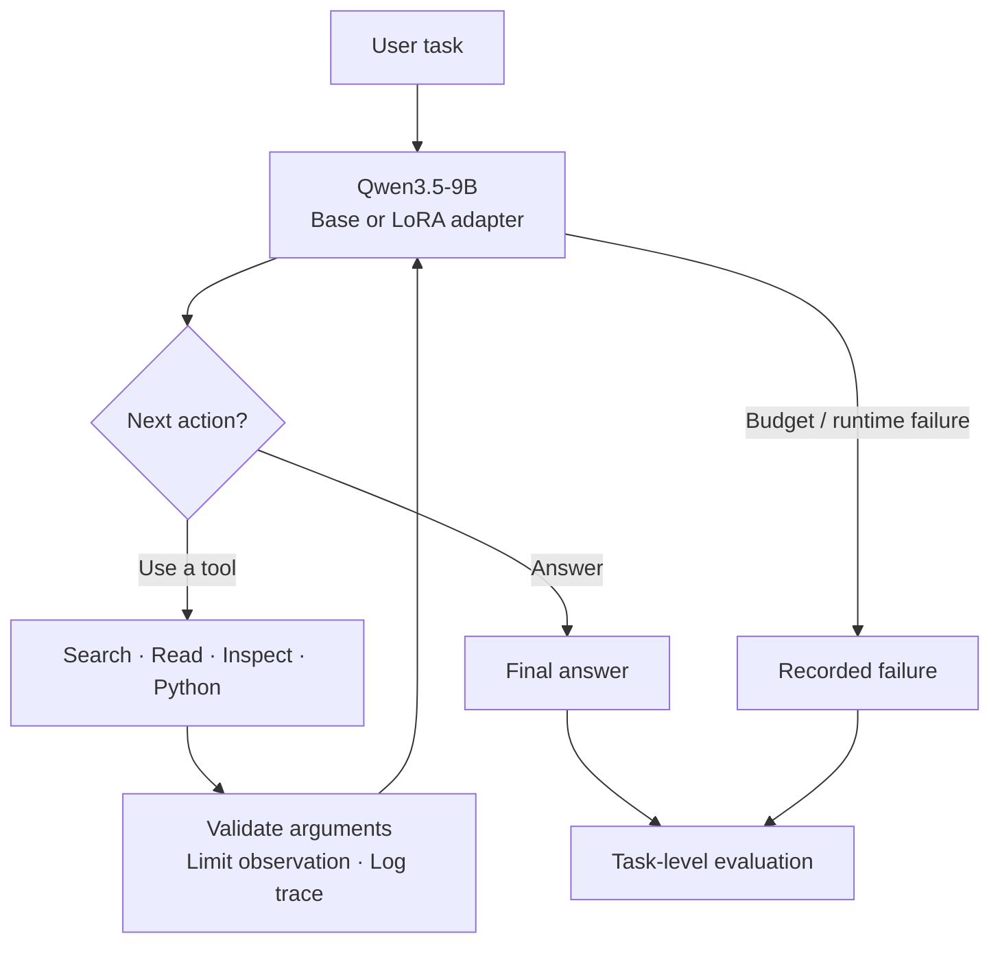

# Small Agent QLoRA

**Training a 9B language model to use tools — and measuring whether it actually solves more tasks.**

[](https://github.com/kolihhan/small-agent-qlora/actions/workflows/ci.yml)


Small Agent QLoRA is an end-to-end research project built around **Qwen3.5-9B**: curate tool-use trajectories, fine-tune lightweight adapters, run an autonomous tool-using agent, and evaluate **complete task outcomes**, not just training loss or next-action accuracy.

One model. Four tools. A bounded agent loop. Reproducible comparisons — including the failures.

[**Results**](#results) · [**Architecture**](#how-it-works) · [**Quickstart**](#quickstart) · [**Reproduce the experiments**](docs/reproduce.md)

---

## Results

### Real-tool evaluation · GAIA100

In one matched run on **100 fixed GAIA validation tasks**, all available models used the same base model, runtime, tool set, evaluator, task IDs and 12-step budget.

| | Base | v7 | **v8 · Step 70** |
| :-- | --: | --: | --: |
| **Correct answers** | 18 / 100 | 25 / 100 | **29 / 100** |
| Final answers produced | 47 | 37 | **56** |
| Tool calls | 724 | 764 | **546** |
| Invalid final outputs | 38 | 50 | **29** |

**18 → 29 correct tasks** · **14 Base errors fixed, 3 Base successes lost** · **178 fewer tool calls than Base**

This is a **single matched comparison**, not a claim that the improvement is stable across repeated runs. The GAIA100 subset was previously examined during development; these numbers are **not an untouched held-out result or an official leaderboard score**.

[Full GAIA protocol, error analysis and paired evidence](docs/gaia-2026-11-23.md) · [Original inference run](https://github.com/kolihhan/small-agent-qlora/actions/runs/45144537782) · [Verified scorecard](https://github.com/kolihhan/small-agent-qlora/actions/runs/45173486537)

### Controlled agent-policy evaluation · 200 tasks

An **earlier, separate** experiment evaluated Base, v3B and v3D on the same frozen synthetic tasks with deterministic tools.

| Model | Exact task success |
| :-- | --: |
| Base | 69 / 200 · 34.5% |
| v3B | 105 / 200 · 52.5% |
| **v3D** | **124 / 200 · 62.0%** |

**34.5% → 62.0%** in the controlled setting. Most of v3D's additional gains came from learning when **not** to call a tool. But v3D did **not** outperform v3B on the older, real-tool GAIA comparison.

These studies use **different runtimes and evaluation conditions**. Their scores should never be combined into one performance curve.

[Controlled-study report and negative ablations](docs/v3d-results.md) · [Original evaluation run](https://github.com/kolihhan/small-agent-qlora/actions/runs/38752732871)

---

## The idea

A tool-using agent needs more than the ability to produce a valid function call. It must decide **which tool to use, whether the evidence is sufficient, and when to stop**.

This project investigates that behavior through three connected pieces:

1. **Training:** prepare verified, non-GAIA tool-use examples and fine-tune Qwen3.5-9B with parameter-efficient LoRA/QLoRA.
2. **Execution:** give the model a small real tool environment, enforce a step budget, and record every decision and failure.
3. **Evaluation:** compare models on identical tasks; distinguish *correct*, *answered but wrong*, *invalid final*, and *tool/runtime failure*.

The result is deliberately a **single-agent system**, not a planner–critic ensemble.

## How it works



The runtime validates arguments, blocks exact duplicate tool calls, caps observations at **2,000 characters**, and records stop reasons and tool errors. It can search the web, read documents, inspect files and run restricted Python. It does **not** support image/audio/video understanding.

| Component | Source |
| :-- | :-- |
| Agent loop and stop logic | [`src/gaia_small_agent/agent/`](src/gaia_small_agent/agent/) |
| Model backends | [`src/gaia_small_agent/model/`](src/gaia_small_agent/model/) |
| Tool implementations | [`src/gaia_small_agent/tools/`](src/gaia_small_agent/tools/) |
| QLoRA and policy evaluation | [`src/gaia_small_agent/training/`](src/gaia_small_agent/training/) |
| Reproduction and architecture | [`docs/reproduce.md`](docs/reproduce.md) · [`docs/architecture.md`](docs/architecture.md) |

## Quickstart

**Requirements:** Python 3.11+, Ollama and an available local Qwen3.5-9B model. This is a local demonstration, **not** the pinned GGUF/llama.cpp setup used to produce the published GAIA scores.

```bash
git clone https://github.com/kolihhan/small-agent-qlora.git
cd small-agent-qlora
python -m pip install -e ".[dev,search,files]"

ollama pull qwen3.5:9b
small-agent doctor --backend ollama --model qwen3.5:9b

small-agent run "Find the original Transformer paper and give its title." \
  --backend ollama --model qwen3.5:9b \
  --workspace runs/demo --output runs/demo/result.json
```

The CLI writes a JSON execution trace. To check the repository **without model inference or a GPU**:

```bash
python -m pytest -q
```

For pinned model hashes, adapter provenance, training/evaluation settings and benchmark access, use the [reproduction guide](docs/reproduce.md).

## What the experiments taught me

- **Better training scores do not guarantee better agents.** v3D reached 62% on the controlled policy test but failed to gain over v3B on the earlier real-tool GAIA100 run.
- **Stopping is part of the policy.** More tool calls can mean more wasted steps, not more useful evidence.
- **A final answer is not necessarily a correct answer.** In the later matched run, v8 Step70 produced 56 final answers but only 29 correct ones.
- **Paired task outcomes beat headline metrics.** Each claimed gain is accompanied by newly-correct tasks, regressions and runtime conditions.

The next unresolved problem is **evidence sufficiency**: helping a small agent recognize when it knows enough to answer, without stopping prematurely.

## Reproducibility & limits

This is a research prototype, **not** a secure sandbox or a production multi-tenant agent. Live search results can change; some GAIA tasks require unsupported modalities. The local Python tool is restricted, but must not be treated as a security boundary for untrusted code.

The 200-task policy benchmark is synthetic. The GAIA100 cohort has been inspected during development. Model weights and gated benchmark data are **not included** in the repository; some older Actions artifacts have expired. The newer GAIA comparison excludes v3D because its exact GGUF artifact was unavailable.

**Start with the evidence:** [GAIA100 matched study](docs/gaia-2026-11-23.md) · [Controlled policy study](docs/v3d-results.md) · [Reproduction guide](docs/reproduce.md) · [Experiment branches](docs/branches.md)
