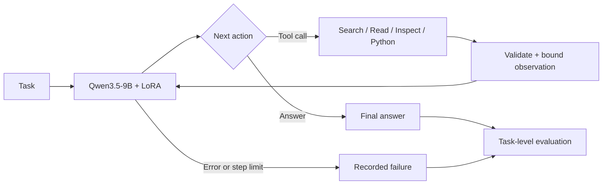

# Small Agent QLoRA

A Qwen3.5-9B tool-using agent built with QLoRA adaptation, a bounded execution loop, and paired evaluation. It combines web search, document reading, file inspection, and restricted Python, with measured results on controlled tasks and real-tool GAIA100.

[](https://github.com/kolihhan/small-agent-qlora/actions/workflows/ci.yml)

## Demo

Run the agent locally with Ollama:

```bash
git clone https://github.com/kolihhan/small-agent-qlora.git
cd small-agent-qlora
python -m pip install -e ".[dev,search,files]"

ollama pull qwen3.5:9b
small-agent doctor --backend ollama --model qwen3.5:9b

small-agent run "Find the original Transformer paper and give its title." \
  --backend ollama --model qwen3.5:9b \
  --workspace runs/demo --output runs/demo/result.json
```

The agent can search the web, read documents, inspect files, and run restricted Python. The CLI records tool calls, stop reasons, and the final answer in a JSON trace.

```text
Question
   ↓
Qwen3.5-9B + optional LoRA adapter
   ↓
Choose tool or answer
   ├── Search / Read / Inspect / Python
   │       ↓
   │   Tool result → next model step
   └── Final answer → trace + evaluation
```

## Results

### Real-tool GAIA100

The matched comparison used **100 fixed GAIA validation tasks**, the same Qwen3.5-9B base model, four tools, prompt, evaluator, and 12-step budget.

| Metric | Base | v7 | v8 Step70 |
|---|---:|---:|---:|
| Correct answers | 18/100 | 25/100 | **29/100** |
| Finished with an answer | 47 | 37 | **56** |
| Invalid final | 38 | 50 | **29** |
| Tool calls | 724 | 764 | **546** |
| Tool errors | 38 | 36 | **30** |

**Correct answers: 18 → 29**, with **178 fewer tool calls** than Base.

The paired comparison found **14 wrong → correct** and **3 correct → wrong** transitions for v8 Step70 against Base. Mean agent steps also decreased from 8.01 to 6.36 per task.

Source of truth: [matched GAIA100 report](docs/gaia-2026-11-23.md), [original inference run](https://github.com/kolihhan/small-agent-qlora/actions/runs/45144537782), and [recovered scorecard](https://github.com/kolihhan/small-agent-qlora/actions/runs/45173486537).

### Controlled tool-use evaluation

A separate experiment compared Base, v3B, and v3D on **200 frozen tasks** with deterministic tools and the same 12-step runtime.

| Model | Exact task success |
|---|---:|
| Base | 69/200 (**34.5%**) |
| v3B | 105/200 (**52.5%**) |
| v3D | **124/200 (62.0%)** |

The v3D continuation improved controlled task success by **9.5 percentage points over v3B**. Most of the gain came from the `no_tool_stop` category: **6/25 → 23/25**, where the correct action was to answer without calling another tool.

Source of truth: [controlled study and ablations](docs/v3d-results.md), [original Actions run](https://github.com/kolihhan/small-agent-qlora/actions/runs/38752732871).

## Two failures worth inspecting

The controlled and real-tool results exposed two different stopping problems.

### 1. Better tool policy can still produce worse task completion

v3D reached **62.0%** on the controlled test, but the earlier matched GAIA100 study showed no accuracy gain over v3B.

| Earlier GAIA100 run | v3B | v3D |
|---|---:|---:|
| Correct | 18/100 | 18/100 |
| Finished with an answer | 44 | 25 |
| Invalid final | 51 | 69 |

v3D often continued searching instead of producing a final answer. Its improvement on controlled stopping cases did not transfer to the real-tool setting.

[Failure analysis](docs/v3d-results.md)

### 2. Finishing the task is different from answering correctly

In the later matched GAIA100 run, v8 Step70 produced **56 final answers**, but **29 were correct**. Another **29 tasks** ended with an invalid final output, including cases where textual tool-call markup appeared when a final answer was required.

```text
v8 Step70 · 100 tasks

29  correct answers
27  completed with a wrong answer
29  invalid final outputs
 8  model errors
 7  model timeouts
```

This separates answer quality from failures to finish the agent loop. Improving finalization alone would not fix the 27 completed-but-wrong answers.

[Matched-run failure breakdown](docs/gaia-2026-11-23.md)

## Architecture



The runtime uses one model and a bounded tool loop. Each tool result is checked and logged before the next model step.

## Engineering choices

- **QLoRA adapters** to fine-tune tool-use behavior without full-model training.
- **Trajectory verification** before training, with checks for exact GAIA task overlap.
- **Bounded execution** with a 12-step budget, argument validation, and duplicate-call blocking.
- **Restricted tool interface** for web search, document reading, file inspection, and Python.
- **Explicit failure tracking** for wrong answers, invalid finals, timeouts, and tool errors.
- **Paired evaluation** to identify which tasks an adapter fixes and which it breaks.

The runtime and training code are under [`src/gaia_small_agent/`](src/gaia_small_agent/). The [architecture notes](docs/architecture.md) cover the backends and tool contracts.

## Reproduce

Run the CPU test suite without downloading a model:

```bash
python -m pytest -q
```

For benchmark reproduction, use the pinned configurations, model and adapter hashes, and workflow records in [docs/reproduce.md](docs/reproduce.md).

The frozen GAIA100 run used llama.cpp with Qwen3.5-9B Q4_K_M. The Ollama demo above runs the same agent code through a different inference backend.

## Evaluation note

The 200-task result is a controlled synthetic policy test. The GAIA100 result uses a previously studied subset of GAIA validation, and the reported v8 comparison is one matched run. The older v3D GAIA study used a different runtime revision; its scores are kept separate. The exact v3D GGUF was unavailable for the later comparison.

For experiment-level details and remaining limitations, see [GAIA100 results](docs/gaia-2026-11-23.md), [v3D results](docs/v3d-results.md), and the [reproduction guide](docs/reproduce.md).
