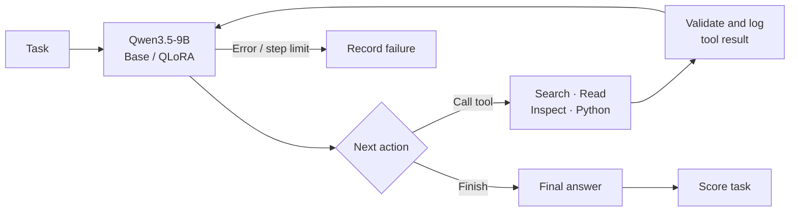

# Small Agent QLoRA

**Fine-tuning Qwen3.5-9B to make better decisions with tools.**

[](https://github.com/kolihhan/small-agent-qlora/actions/workflows/ci.yml)


I built this project to answer a simple question: **can fine-tuning a small language model actually help it finish more tasks?**

I trained Qwen3.5-9B with QLoRA and tested the adapters in an agent that can search the web, read documents, inspect files, and run Python. The biggest lesson was that choosing a tool is only half the problem. Knowing when to stop matters just as much.

[Results](#results) · [How it works](#how-it-works) · [Quickstart](#quickstart) · [Reproduce](docs/reproduce.md)

## Results

### GAIA100: real tools, same tasks

I compared three models on the same 100 GAIA validation tasks, using the same agent runtime, tools, prompt, and evaluation settings.

| | Base | v7 | **v8 Step70** |
| :-- | --: | --: | --: |
| **Correct answers** | 18 / 100 | 25 / 100 | **29 / 100** |
| Tasks finished with an answer | 47 | 37 | **56** |
| Tool calls | 724 | 764 | **546** |
| Invalid final outputs | 38 | 50 | **29** |

**18 → 29 correct answers, with 178 fewer tool calls.**

Looking at individual tasks, v8 fixed **14** Base mistakes and lost **3** previously correct answers. That gives a net gain of **11 tasks** in this matched run.

[Experiment details and failure analysis](docs/gaia-2026-11-23.md) · [Original run](https://github.com/kolihhan/small-agent-qlora/actions/runs/45144537782) · [Verified results](https://github.com/kolihhan/small-agent-qlora/actions/runs/45173486537)

### Controlled tool-use tasks

An earlier experiment tested Base, v3B, and v3D on 200 frozen tasks with deterministic tools.

| Model | Exact task success |
| :-- | --: |
| Base | 69 / 200 · 34.5% |
| v3B | 105 / 200 · 52.5% |
| **v3D** | **124 / 200 · 62.0%** |

**34.5% → 62.0%** on the controlled test.

Most of v3D's improvement came from learning to answer directly when a tool wasn't needed. That worked well here, but the same adapter struggled to stop searching on real-tool GAIA tasks. It's what led me to pay more attention to how agents finish tasks, rather than only whether they choose the next action correctly.

[Controlled experiment and ablations](docs/v3d-results.md) · [Original evaluation](https://github.com/kolihhan/small-agent-qlora/actions/runs/38752732871)

## How it works

The setup is intentionally simple: one Qwen model, one agent loop, four tools, and a fixed step budget.



The runtime checks tool arguments, blocks repeated calls, limits tool observations to 2,000 characters, and saves each step of the run. This makes it possible to inspect what the agent did, where it got stuck, and why a final answer was wrong.

I kept the agent architecture small so I could study the effect of the model and training data without adding a separate planner or critic.

## Training and evaluation

The workflow connects training to actual agent behavior:

1. Prepare and verify tool-use trajectories.
2. Fine-tune Qwen3.5-9B adapters with LoRA/QLoRA.
3. Run the base model and adapters through the same agent tasks.
4. Compare task correctness, completion, tool usage, and failure traces.

The experiments also include unsuccessful training variants. Those runs helped identify a recurring issue: a model can improve at tool use while getting worse at deciding when to finish.

## Quickstart

You need **Python 3.11+** and **Ollama** to try the agent locally.

```bash
git clone https://github.com/kolihhan/small-agent-qlora.git
cd small-agent-qlora
python -m pip install -e ".[dev,search,files]"

ollama pull qwen3.5:9b
small-agent doctor --backend ollama --model qwen3.5:9b

small-agent run "Find the original Transformer paper and give its title." \
  --backend ollama --model qwen3.5:9b \
  --workspace runs/demo --output runs/demo/result.json
```

The command saves a JSON trace at `runs/demo/result.json`. You can also check the code without running a model:

```bash
python -m pytest -q
```

The published GAIA evaluation used a pinned llama.cpp/GGUF setup. The [reproduction guide](docs/reproduce.md) has the exact configuration.

## Project structure

| Path | What you'll find |
| :-- | :-- |
| [`src/gaia_small_agent/agent/`](src/gaia_small_agent/agent/) | Agent loop and stopping logic |
| [`src/gaia_small_agent/tools/`](src/gaia_small_agent/tools/) | Search, read, inspect, and Python tools |
| [`src/gaia_small_agent/model/`](src/gaia_small_agent/model/) | Model backends |
| [`src/gaia_small_agent/training/`](src/gaia_small_agent/training/) | QLoRA and policy evaluation |
| [`tests/`](tests/) | Runtime and evaluation checks |
| [`docs/`](docs/) | Architecture, experiments, and reproduction |

## What I'm working on next

The question I'm most interested in now is **evidence sufficiency**: how can a small agent tell when it has enough information to answer?

Searching longer doesn't always help. Sometimes the agent already has the right evidence and keeps going. Sometimes it stops with an answer that sounds reasonable but is wrong. I want to make that decision more reliable.

## Evaluation notes

The GAIA100 results come from a previously studied validation subset and one matched run. The 200-task test uses synthetic, deterministic tasks. These experiments used different runtime versions, so their scores are reported separately.

For the precise settings, model hashes, adapter history, and known failure cases, see the [GAIA report](docs/gaia-2026-11-23.md), [controlled study](docs/v3d-results.md), and [reproduction guide](docs/reproduce.md). The restricted Python tool is for local research, rather than running untrusted code.
