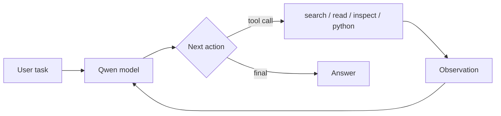

# Small-Agent QLoRA

**Post-training a Qwen3.5-9B tool agent, then testing whether the behavior actually improves.**

Most tuning demos stop at training loss. This project focuses on agent behavior: diagnose failure modes, change the supervision, run QLoRA/SFT, and verify the result on frozen closed-loop evaluations.

## Results

### Controlled closed-loop evaluation

Same runtime, frozen 200-task policy test, deterministic tools, temperature 0, 12-step limit.

| Model | Correct | Exact success | Completion |
|---|---:|---:|---:|
| Base | 69 / 200 | 34.5% | 98.0% |
| v3B | 105 / 200 | 52.5% | 100.0% |
| **v3D** | **124 / 200** | **62.0%** | **99.5%** |

**Base 34.5% → v3B 52.5% → v3D 62.0%.** v3D gained 19 correct tasks over v3B and passed the preregistered promotion rule.

The gain was concentrated rather than universal: `no_tool_stop` improved from **6/25 → 23/25**, `strategy_switch` from **0/25 → 2/25**, while `failure_recovery` remained **0/25**.

Evidence: [run 38752732871](https://github.com/kolihhan/small-agent-qlora/actions/runs/38752732871) · [full controlled analysis](docs/v3d-results.md)

### External GAIA100 check

The final models were also compared on a frozen matched GAIA 2023 validation Evaluation100 run.

| Model | Correct | Accuracy | Completion | Duplicate calls blocked |
|---|---:|---:|---:|---:|
| Base | 9 / 100 | 9% | 45% | 78 |
| v3B | 18 / 100 | 18% | 44% | 66 |
| v3D | 18 / 100 | 18% | 25% | 127 |

**Base 9% → v3B 18% → v3D 18%.** v3B improved over Base; v3D added no further external accuracy gain.

The useful failure was in the trace: v3D frequently kept searching instead of finalizing. There were **20 v3B-final → v3D-non-final** transitions versus **1** in the opposite direction, while tool errors did not increase. The main external regression was therefore **over-search / failure to finalize**, not a generic collapse in tool use.

Evidence: [run 38911211243](https://github.com/kolihhan/small-agent-qlora/actions/runs/38911211243) · [paired GAIA failure analysis](docs/gaia-v3d-results.md)

## Experiment story

The project evolved through measured failures rather than a straight line of better checkpoints.

1. **Base** — established the frozen policy baseline at **34.5%** closed-loop exact success.
2. **v3B** — completion-only QLoRA/SFT improved the policy to **52.5%** and improved GAIA100 from **9% to 18%**.
3. **v3C** — full-trajectory supervision was tested as an ablation. It regressed the frozen next-action score from **32/64 to 27/64** and reduced correct finals from **14/29 to 8/29**, so it was rejected.
4. **v3D** — failure analysis showed that capability labels alone did not identify the correct state inside a trajectory. A state-aware corrective continuation selected later corrective decisions instead of accidentally supervising deliberately bad first actions. It reached **62.0%** on the controlled closed-loop test.
5. **External check** — GAIA showed the boundary of that improvement: v3D kept the same **18%** accuracy as v3B but developed a stronger stopping problem on longer trajectories.

That split is intentional: the repo keeps the negative ablation and the external regression instead of turning the project into a benchmark-only success story.

## Agent design

One model chooses the next action. There is no planner/router/critic graph around it.



The runtime owns the execution boundaries around the model: bounded tool errors, duplicate-call blocking, model timeouts, source-size limits, restricted subprocess execution for Python, and trace/metric persistence.

## Training

The reported experiment uses **Qwen3.5-9B** and evaluates the final models as Q4_K_M GGUFs with `llama.cpp`.

v3D is a corrective continuation from v3B:

- 24 state-aware corrective examples
- 12 tool-call targets + 12 final-answer targets
- 24 optimizer steps
- learning rate `1e-4`
- max length 1024
- four sequential batches of six examples
- optimizer state preserved across batches
- only layer-31 LoRA parameters trainable

The layer-31 restriction is a compute compromise. On standard GitHub CPU runners, an all-layer backward step did not finish after roughly 5h51m; the shortest measured layer-31 optimizer step took about 24.1 minutes. This is not presented as equivalent to full all-linear QLoRA.

Training evidence: [run 38561069365](https://github.com/kolihhan/small-agent-qlora/actions/runs/38561069365)

## Reproduce

The final repository keeps the workflows that correspond to the evidence chain:

- [`ci.yml`](.github/workflows/ci.yml) — package install, CLI smoke, tests, compilation
- [`hf-zero-gpu-train-v3b.yml`](.github/workflows/hf-zero-gpu-train-v3b.yml) — v3B training
- [`v3c-sft-heldout.yml`](.github/workflows/v3c-sft-heldout.yml) — negative full-trajectory ablation
- [`v3d-cpu-batched-continuation.yml`](.github/workflows/v3d-cpu-batched-continuation.yml) — v3D corrective continuation
- [`v3d-heldout-next-action.yml`](.github/workflows/v3d-heldout-next-action.yml) — frozen 64 next-action comparison
- [`v3d-closed-loop.yml`](.github/workflows/v3d-closed-loop.yml) — frozen 200-task closed-loop comparison
- [`gaia-v3d-clean-same-runner.yml`](.github/workflows/gaia-v3d-clean-same-runner.yml) — matched Base / v3B / v3D GAIA100 check

For a lightweight local runtime smoke test:

```bash
python -m pip install -e ".[search,files]"
small-agent doctor
small-agent run "Find the relevant evidence and answer concisely." --output runs/task/result.json
```

Evaluation dependencies:

```bash
python -m pip install -e ".[eval,search,files]"
```

The full Transformers/QLoRA path requires the heavier training extras and a compatible environment:

```bash
python -m pip install -e ".[eval,search,files,train]"
small-agent doctor --backend transformers
```

## Evidence

- [`docs/v3d-results.md`](docs/v3d-results.md) — controlled experiment, negative ablation, training constraints, claim boundary
- [`docs/gaia-v3d-results.md`](docs/gaia-v3d-results.md) — matched GAIA100 paired failure analysis
- [`docs/verification.md`](docs/verification.md) — runtime and verification notes
- `evidence/` and `evals/` — frozen evaluation inputs and saved summaries used during development

## What this project demonstrates

- diagnosing agent-policy failures instead of tuning blindly;
- designing SFT/QLoRA supervision from observed failure states;
- rejecting a negative ablation rather than cherry-picking it;
- separating one-step policy probes from closed-loop evaluation;
- running matched external evaluation and tracing regressions back to behavior;
- keeping claims bounded to what the evidence actually supports.

## Limits

- The 200-task deterministic policy test is controlled and synthetic; it is not a general real-world agent benchmark.
- v3D did **not** beat v3B on external GAIA100.
- `failure_recovery` remains unresolved in the final controlled result.
- The v3D continuation trained only layer-31 LoRA parameters because of CPU constraints.
- The Python tool is process-isolated and time-limited, but it is not a hardened hostile-code sandbox.

The supported headline is therefore narrow: **state-aware corrective QLoRA improved the frozen controlled closed-loop policy evaluation from 52.5% to 62.0%; matched GAIA100 showed a v3B gain over Base, but no additional v3D accuracy gain and a clear over-search termination weakness.**
